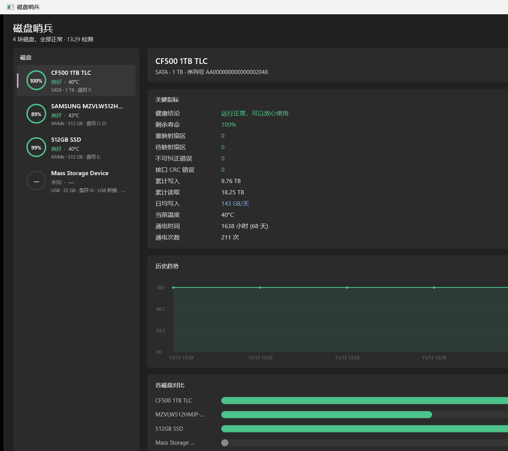

# 磁盘哨兵 DiskSentinel

> 一个用 WinUI 3 写的 Windows 磁盘健康监控小工具。
> **开机静默检测一次，记完账立刻退出，绝不常驻后台。**



---

## 为什么做这个

CrystalDiskInfo 显示的「健康度 89%」是**磨损进度**，不是故障预告。但很多人看到它掉 1% 就慌，又不知道到底该看什么。

这个工具帮你把真正重要的东西一次列清：**介质错误、备用块、坏道计数、不安全关机**，并且**记录历史**——每次开机记一笔，攒几天就能看出这块盘到底在不在加速老化。

---

## 功能

### 磁盘健康一览
- 左侧圆环显示每块盘的剩余寿命，颜色区分等级：🟢 良好 / 🟡 注意 / 🔴 危险 / ⚪ 未知
- 右侧显示该盘的全部关键指标，一句话给出健康结论

### 完整 SMART 数据
| NVMe 盘 | SATA 盘 |
|---|---|
| 剩余寿命 / 已用磨损 | 剩余寿命 |
| 备用块（含阈值） | 重映射扇区 |
| **介质错误** | 待映射扇区 |
| 累计写入 / 读取 | 不可纠正错误 |
| 控制器忙碌时间 | 接口 CRC 错误 |
| | 累计写入 / 读取 / 日均 |

### 历史趋势图
折线图可切换四种指标，全部 Canvas 手绘，零第三方图表库：
- 健康度 (%) — 看寿命消耗速度
- 累计写入 (TB) — 斜率就是磨损速度
- 温度 (°C) — 看散热是否稳定
- 通电时间 (h) — 看使用强度

### 多盘对比
横向条形图，一眼看出哪块盘最不健康。健康度都在高位时会自动放大差异，避免 89% 和 100% 看起来一样长。

### 开机检测，跑完就走
用 Windows 计划任务实现，**不是自启动项**：

```
触发器：登录后，延迟 30 秒
动作：DiskSentinel.exe --bootcheck
权限：最高权限
隐藏：是
```

`--bootcheck` 模式下：扫描 SMART → 追加写入历史 → **立即 `Environment.Exit(0)`**。
不创建窗口，不注册托盘图标，实测从启动到退出约 **1 秒**，跑完查不到任何残留进程。

---

## 安装

### 方式一：安装包（推荐）

从 [Releases](https://github.com/fotlim/DiskSentinel/releases) 下载 `DiskSentinel-x.x.x-Setup.exe`，双击安装。

安装时可勾选「注册开机自动检测」，装完即用。卸载时会自动移除计划任务。

### 方式二：便携版

下载 `DiskSentinel-x.x.x-portable.zip`，解压后直接运行 `DiskSentinel.exe`，无需安装。

### 环境要求

- Windows 10 1809+ / Windows 11
- [.NET 8 桌面运行时](https://dotnet.microsoft.com/download/dotnet/8.0)
- [Windows App Runtime 1.8](https://learn.microsoft.com/windows/apps/windows-app-sdk/downloads)

---

## 使用

1. 打开程序，主界面会立即扫描所有磁盘
2. 点右下角 **「注册开机检测」**，授权 UAC 后即可
3. 以后每次开机自动记录，攒几次就能看趋势
4. 想取消就再点一次（按钮会变成「取消开机检测」）

### 数据位置

优先 `%LOCALAPPDATA%\DiskSentinel\`，写不进去时自动退到程序目录的 `Data\`（便携模式）。

| 文件 | 内容 |
|---|---|
| `history.jsonl` | 每次检测一行 JSON，可用文本编辑器直接查看 |
| `bootcheck.log` | 开机检测的人类可读日志 |

历史最多保留 4000 行，超了自动裁剪。

---

## 技术实现

### NVMe：原生协议查询
`IOCTL_STORAGE_QUERY_PROPERTY` + `StorageDeviceProtocolSpecificProperty`，
请求 NVMe Log Page 0x02（SMART/Health Information），512 字节结构自己解析。

只读句柄即可，不需要管理员权限。

### SATA：绕开系统的写保护
Windows **拒绝对已挂载卷的物理盘做写访问**（`ERROR_ACCESS_DENIED`），
而 ATA SMART 命令 `IOCTL_SMART_RECEIVE_DRIVE_DATA` 必须用读写句柄。

以下路径全部失败（实测 `err=5`）：
- `IOCTL_SMART_RECEIVE_DRIVE_DATA`
- `IOCTL_ATA_PASS_THROUGH`
- `IOCTL_SCSI_PASS_THROUGH`
- 启用 `SeManageVolumePrivilege` 特权

**最终解法**：storage 驱动在 `root\wmi` 暴露了 `MSStorageDriver_ATAPISmartData`，
里面就是原始 ATA SMART 结构，与直连命令拿到的内容完全一致。

### 累计写入量的单位陷阱
SMART 属性 241（累计写入）/ 242（累计读取）的单位**不是** 512 字节 LBA。

实测标定：写入 512 MiB → 计数器增加 16，得出**每单位 = 32 MiB**（65536 个扇区）。
早期按 512 字节计算，会把 9.76 TB 错误显示成 0 TB。

### PowerShell 调用的两个坑
用 `Process.Start` 调 `powershell.exe` 读 WMI 时：
1. `-Command -` + stdin 会**吞掉多行脚本里的花括号**
2. 不加 `-OutputFormat Text`，进度流会被包装成 CLIXML 混进 STDERR

正确写法：
```
powershell.exe -NoProfile -NonInteractive -OutputFormat Text -EncodedCommand <Base64(UTF-16LE 脚本)>
```

### 零第三方依赖
- 图表：全部 Canvas 手绘，不引图表库
- WMI：DeviceIoControl 原生调用，不引 `System.Management`
- 结果：启动快、内存小（约 140 MB）、单文件依赖少

---

## 从源码构建

```powershell
# 需要 .NET 8 SDK + Windows App SDK
cd DiskSentinel
dotnet build -c Release -p:Platform=x64
```

### 生成安装包

```powershell
# 1. 先发布
dotnet publish -c Release -p:Platform=x64 -o publish

# 2. 用 Inno Setup 编译安装脚本
"C:\Program Files (x86)\Inno Setup 6\ISCC.exe" installer.iss
```

安装包输出在 `dist\DiskSentinel-x.x.x-Setup.exe`。

---

## 项目结构

```
DiskSentinel/
  App.xaml.cs              启动分流：--bootcheck 走静默模式，否则开窗口
  MainWindow.xaml(.cs)     主界面
  installer.iss            Inno Setup 安装脚本
  Models/
    SmartSnapshot.cs       数据模型 + 健康判定规则
    DiskItemVm.cs          界面绑定视图模型
  Services/
    NativeSmart.cs         Win32 原生调用（DeviceIoControl）
    SmartReader.cs         扫描调度：NVMe → ATA → WMI 逐级降级
    WmiFallback.cs         SATA 走 root\wmi 的原始 SMART
    HistoryStore.cs        历史落盘（JSONL）
    ReportBuilder.cs       快照 → 界面文本
    BootTask.cs            计划任务注册/注销 + 静默检测入口
  Controls/
    ChartCanvas.cs         手绘图表（折线 + 横向条）
  Assets/
    app.ico               多尺寸图标
```

---

## 已知限制

| 情况 | 表现 |
|---|---|
| USB 移动硬盘 / U 盘 | 通常读不到 SMART，显示「未知」。USB 桥接芯片普遍不透传 SMART 命令 |
| 部分 SATA 盘 | 不提供属性 241/242，累计写入显示为空 |
| 机械硬盘 | 没有磨损计数，只要没坏道就按 100% 显示 |
| 首次运行 | 历史为空，趋势图显示提示，攒几次就好 |

---

## 许可

[MIT License](LICENSE)

---

*不引第三方图表库，全部 Canvas 手绘；不引 WMI 库，全部 DeviceIoControl 原生调用。*
